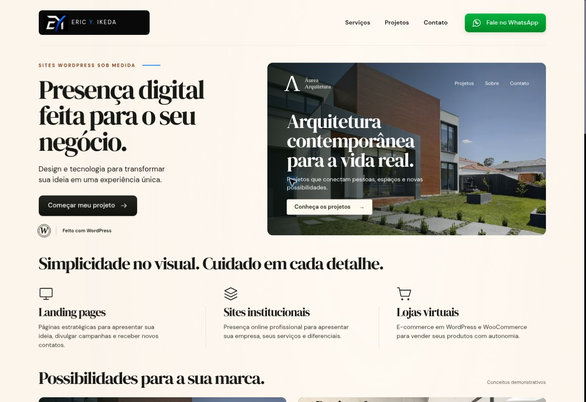

# Loja de serviços WordPress

Página comercial em `/loja`, publicada na raiz de `loja.ericyikeda.com.br` pelo middleware da Vercel. A página usa a estrutura React/Vite do portfólio; apresenta serviços de criação em WordPress, sem instalar uma instância WordPress ou oferecer checkout nesta aplicação.

- Conteúdo e links: `src/ShopPage.tsx`.
- Identidade visual e responsividade: `src/shop.css`.
- Imagens WebP locais e créditos: `public/shop/`.
- Os dois exemplos são conceitos demonstrativos, identificados como tal, com prévia em diálogo acessível.
- Orçamentos abrem o WhatsApp já utilizado no projeto (`DEFAULT_WHATSAPP`), sem envio automático de mensagens.
- Menu mobile, FAQ nativo, suporte a teclado e preferência de movimento reduzido.
- HTML pré-renderizado, SEO e canonical próprios; validação CSP inclui a nova página.

O subdomínio deve ser adicionado ao mesmo projeto na Vercel. O CNAME no Registro.br, isoladamente, não associa o endereço ao projeto.

Validação: `npx tsc -b`, `npm run build` e `git diff --check`; revisão de desktop, viewport mobile de 390 px, abertura de prévias, menu e FAQ.

